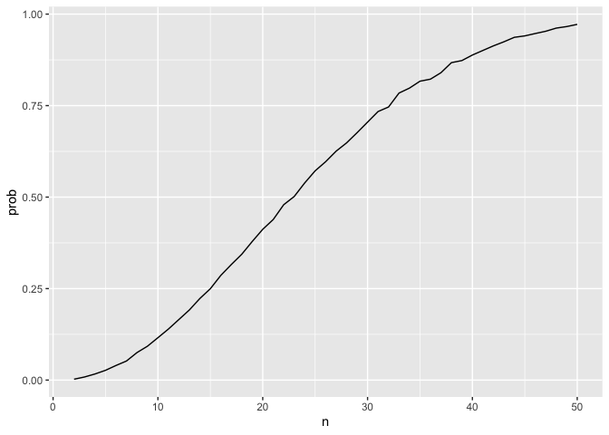

P8105 HW 5
================
Isabella Nguyen
2026-11-17

#### 0. Loading Necessary Packages

``` r
library(tidyverse)
```

    ## ── Attaching core tidyverse packages ──────────────────────── tidyverse 2.0.0 ──
    ## ✔ dplyr     1.2.1     ✔ readr     2.2.0
    ## ✔ forcats   1.0.1     ✔ stringr   1.6.0
    ## ✔ ggplot2   4.0.3     ✔ tibble    3.3.1
    ## ✔ lubridate 1.9.5     ✔ tidyr     1.3.2
    ## ✔ purrr     1.2.2     
    ## ── Conflicts ────────────────────────────────────────── tidyverse_conflicts() ──
    ## ✖ dplyr::filter() masks stats::filter()
    ## ✖ dplyr::lag()    masks stats::lag()
    ## ℹ Use the conflicted package (<http://conflicted.r-lib.org/>) to force all conflicts to become errors

``` r
library(rvest)
```

    ## 
    ## Attaching package: 'rvest'
    ## 
    ## The following object is masked from 'package:readr':
    ## 
    ##     guess_encoding

``` r
library(purrr)

set.seed(1)
```

#### Problem 1.

``` r
bday = function(n) {
  bdays = sample.int(365, size = n, replace = TRUE)
  dup = length(unique(bdays)) < n
  
  return(dup)
}

bday_results_df = 
  expand_grid(
    n = 2:50,
    iter = 1:10000
  ) |>
  mutate(
    duplicate = map_lgl(n, bday)
  ) |>
  group_by(n) |>
  summarize(
    prob = mean(duplicate)
  )

bday_results_df |>
  ggplot(aes(x = n, y = prob)) + 
  geom_line()
```

<!-- -->

Probability that at least two people in a group with share the same
birthday increases as group size increases. There are steep increases in
probability between n = 10 and around n = 30. The probability of a
duplicate birthday crosses the 50% mark when the group size is 23 These
steep increases start to flatten as group size approaches n = 50. When
the group size is 50 individuals, the probability simulated is close to
100, at around 97.2%.
