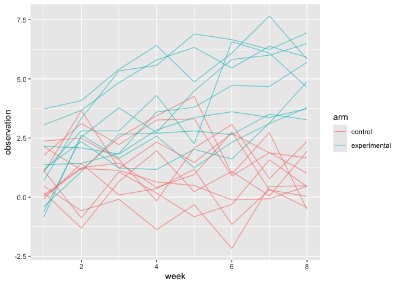

P8105 HW 5
================
Isabella Nguyen
2026-11-17

#### 0. Loading Necessary Packages

``` r
library(tidyverse)
```

    ## ── Attaching core tidyverse packages ──────────────────────── tidyverse 2.0.0 ──
    ## ✔ dplyr     1.2.1     ✔ readr     2.2.0
    ## ✔ forcats   1.0.1     ✔ stringr   1.6.0
    ## ✔ ggplot2   4.0.3     ✔ tibble    3.3.1
    ## ✔ lubridate 1.9.5     ✔ tidyr     1.3.2
    ## ✔ purrr     1.2.2     
    ## ── Conflicts ────────────────────────────────────────── tidyverse_conflicts() ──
    ## ✖ dplyr::filter() masks stats::filter()
    ## ✖ dplyr::lag()    masks stats::lag()
    ## ℹ Use the conflicted package (<http://conflicted.r-lib.org/>) to force all conflicts to become errors

``` r
library(rvest)
```

    ## 
    ## Attaching package: 'rvest'
    ## 
    ## The following object is masked from 'package:readr':
    ## 
    ##     guess_encoding

``` r
library(purrr)

set.seed(1)
```

#### Problem 1.

``` r
bday = function(n) {
  bdays = sample.int(365, size = n, replace = TRUE)
  dup = length(unique(bdays)) < n
  
  return(dup)
}

bday_results_df = 
  expand_grid(
    n = 2:50,
    iter = 1:10000
  ) |>
  mutate(
    duplicate = map_lgl(n, bday)
  ) |>
  group_by(n) |>
  summarize(
    prob = mean(duplicate)
  )

bday_results_df |>
  ggplot(aes(x = n, y = prob)) + 
  geom_line()
```

<!-- -->

Probability that at least two people in a group with share the same
birthday increases as group size increases. There are steep increases in
probability between n = 10 and around n = 30. The probability of a
duplicate birthday crosses the 50% mark when the group size is 23 These
steep increases start to flatten as group size approaches n = 50. When
the group size is 50 individuals, the probability simulated is close to
100%, at 97.2%.

#### Problem 2

*Creating a dataframe containing all file names*

``` r
prob_2_data = tibble(
  files = list.files("./data")
) |>
  mutate(path = str_c("./data/", files),
       data = map(path, read_csv)
       ) |>
  unnest(data) |>
  janitor::clean_names() |>
  separate(files, into = c("arm", "id"), sep = "_") |>
  mutate(
    id = str_remove(id, "\\.csv"), 
    arm = case_match(arm,
                     "con" ~ "control",
                     "exp" ~ "experimental")
  ) |>
  pivot_longer(
    cols = week_1:week_8,
    names_prefix = "week_",
    names_to = "week",
    values_to = "observation"
  ) |>
  mutate(week = as.numeric(week)) |>
  select(-path) |> 
  relocate(id)

prob_2_data |>
  ggplot(aes(x = week, y = observation, color = arm, group = interaction(arm, id))) + 
  geom_line(alpha = 0.6)
```

<!-- -->

At week one, the two study arms start out similarly. Over the 8 weeks,
observation values in the experimental arm increase. The observations in
the control arm stay flat over the observation period. By the end of the
observation period, the control and experimental arm’s observations are
separated, with all observations in the experimental arm higher than the
controls.

#### Problem 3

``` r
#t test output: estimate is our mu hat here

sim_ttest = function(n = 30, mu = 0, sigma = 5) {
  sim_data = tibble(
    x = rnorm(n, mean = mu, sd = sigma)
  )
  
  t.test(sim_data |> pull(x), mu = 0) |> 
  broom::tidy() |>
    select(estimate, p.value)
}
```
